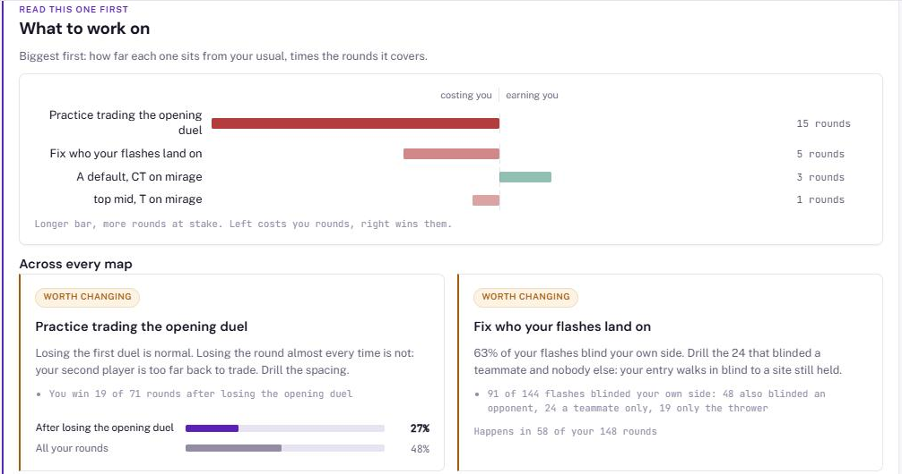
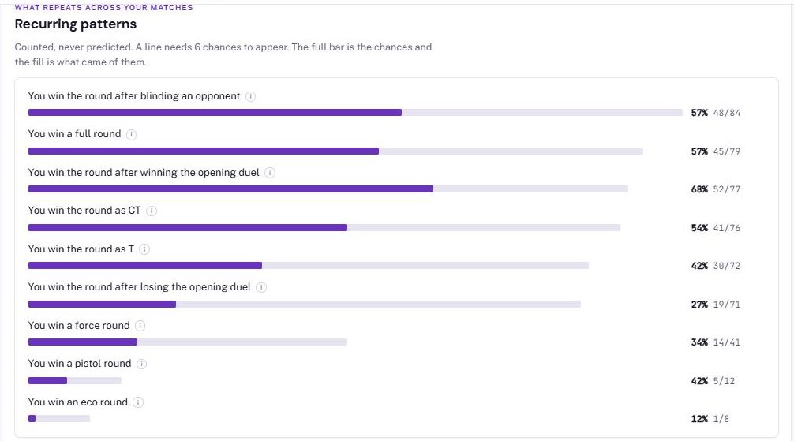
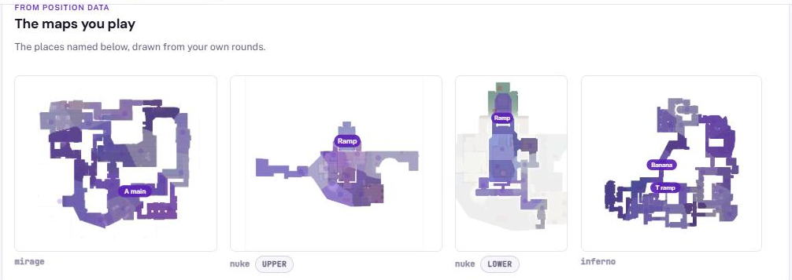

<p align="center"></p>

# Counterplay

**Match analysis for collegiate Counter-Strike 2 teams. Live at [counterplaycs.com](https://counterplaycs.com).**

A coach uploads their team's match demos and gets back player and team statistics, a
report for every match, and the patterns the team repeats without deciding to. It is not
a replay viewer. It reads the match and says which seconds of it were expensive, and every
number on the page carries the rounds it came from, so a coach can open the demo and check.

Built and run solo by Johan Johnson, September 2026 onward: data pipeline, models, web app,
deployment and the first conversations with coaches.

**At a glance:** Python, FastAPI, SQLite, LightGBM, PyTorch, the Anthropic Claude API with
schema-constrained outputs and a tested checker, hybrid retrieval with sentence-transformers,
Docker built and smoke-tested in GitHub Actions, 250+ tests, and AWS monitoring defined in
Terraform. Used by collegiate teams.

> This repository is a portfolio snapshot of the product's source and its full commit
> history. Deployment configuration, operating notes and customer contact material are not
> included. All rights reserved; see [LICENSE](LICENSE).

---

## What it does

- **Parses raw demo files** as they arrive from FACEIT or Valve matchmaking (zstd, gzip
  and bzip2 packing detected by magic number, never by file extension).
- **Reconstructs each round from events**, not ticks: about 12 rows per round instead of
  about 7,000. Win probability only moves when someone dies or the bomb goes down, which is
  why the whole thing runs on a single small server.
- **Checks every parse** with 13 automated validations before anything reaches a page.
- **Reads the season**: per-player and per-team rates, opening duels, trades, utility,
  buys, and a zone map of where a team's rounds are decided.
- **Judges a team against collegiate teams in the same spot**, with an exact binomial test,
  so it flags only differences the data can support.
- **Writes a short coaching note** with the Anthropic Claude API, under rules that let no
  unsupported number reach a coach (see below).
- **Shares and hands over**: read-only share links, and a one-time link that transfers a
  team built from a coach's public demos to that coach's own account.

## What a coach sees

Screenshots from the [sample report](https://counterplaycs.com/sample-report) on the live
site. The team is fictional and its numbers are invented, so no real team's data is shown;
the layout, charts and maps are the product's own.

**What to work on**, ranked by how many rounds each habit costs or wins, with the counts
behind every claim:

<p align="center"></p>

**Recurring patterns**: every rate printed with the chances it came from, so a coach can
open the demo and check it:

<p align="center"></p>

**Zone maps**: positions placed into named areas by walking distance over ground players
actually stood on, so a place never bleeds through a wall:

<p align="center"></p>

## How it fits together

```mermaid
flowchart LR
    U[Coach uploads demo] --> W[FastAPI app]
    W --> Q[(SQLite)]
    Q --> K[Background worker]
    K --> P[Parser: demoparser2<br/>events to round state<br/>13 validation checks]
    P --> Q
    Q --> R[report.py: every reading<br/>rates with denominators]
    R --> W
    subgraph Offline, on the collegiate corpus
        C[(138 collegiate matches)] --> M[LightGBM win probability<br/>+ isotonic calibration]
        C --> B[Collegiate benchmarks<br/>league_rates.json, benchmark.json]
        C --> E[Economy curve<br/>with team-strength control]
    end
    M --> R
    B --> R
    E --> R
```

## The machine learning, and the decisions behind it

The model work is deliberately boring in architecture and careful in evaluation. The
longer write-up is in [docs/decision-engine.md](docs/decision-engine.md); the short version:

- **Gradient-boosted trees on tabular features, not a sequence model.** What matters is not
  accuracy but **calibration**: when the model says 30%, that side must win about 30% of the
  time, or every number shown to a coach is wrong. Raw LightGBM is overconfident at the
  extremes here, so it is wrapped in an isotonic calibrator fitted on a third, disjoint split.
- **Every split is by match, never by row.** Rows within a round are highly correlated, and
  a random split leaks and flatters every metric.
- **Calibration is gated against a measured noise floor**, not a fixed threshold. A
  perfectly calibrated model still scores about 0.034 on max-bin error from sampling noise
  alone on 7,700 rows, so a fixed gate mostly measures test-set size. Expected calibration
  error is compared to the error a perfect model would show at the same row count.
- **Measured across 20 seeds, and the baselines won.** Simple baselines run on the same
  splits and seeds (a 7-leaf LightGBM, a logistic regression) beat the first production
  model by 0.02 to 0.03 AUC: it was too big for about 4,000 college rounds, not too small.
  The scorer was replaced with the smaller booster plus position features and more training
  maps only after it passed a holdout rule fixed in advance (DIV 20 of 20 against 18).
  It still fails a quarter of random splits on calibration, so the product does not show a
  coach a raw probability from it. [ml/README.md](ml/README.md) has every table.
- **A PyTorch model to test whether positions matter.** `WinNet` (ml/) encodes all ten
  players, conditioned on the map, with one self-attention layer across them and pooling per
  side, about 27,000 parameters. Pretrained on 104 pro maps and fine-tuned on college maps it
  matched the best tree model at 0.907 median AUC on held-out division matches. Positions
  carry real signal; the network is limited by data, not design.
- **Moments are ranked by excess cost, not raw cost.** Ranked on raw win-probability change,
  every top moment is a lost 1v1, which is arithmetic, not insight. Comparing each moment
  with what that situation normally costs surfaces the coachable ones instead: 3v1 and 2v1
  post-plant rounds a team was winning and threw. Getting that baseline right took three
  attempts; both failures are written up.
- **The economy model is one learned curve plus measured rules.** P(win) from the two sides'
  equipment ratio, fitted with a team-strength control (89% of the slope survives it,
  because a better team is also a richer one). Money rules were measured off demos rather
  than remembered, and each buy call is simulated over the rest of the half.
- **Missing data is unknown, not a miss.** Some demos carry no blind events; treating every
  flash in them as blinding nobody produced false advice, so those matches are excluded from
  flash figures and from the reference they are judged against.

## The coaching note: an LLM under rules

Statistics are not coaching, so each team also gets a short note at the top of its page,
written with the Anthropic Claude API ([app/coach.py](app/coach.py)):

- **Code computes, the model writes.** Every fact is computed first, with an id, a scope and
  a verdict against collegiate teams. Claude only drafts, edits and reviews, each call
  returning schema-constrained JSON that cites the fact ids it uses.
- **A deterministic checker decides.** It refuses any number, round, kind of point, ranking
  word or length the cited facts do not support, and any link that retrieval did not return
  for that point. A failing note gets one rewrite with the problems listed; a second failure
  is stored as failed and nothing is shown.
- **A person approves, at first.** Notes wait for approval until 20 in a row pass with no
  edits; one edit or rejection turns the queue back on.
- **Hybrid retrieval for links** ([tools/resources.py](tools/resources.py)): a vetted library
  is filtered by map, side and topic, then ranked by sentence-transformers embeddings, after
  meaning-only search kept returning guides for the wrong side.
- **Privacy by construction.** Only the team name and fact sentences leave the server: no
  demo files, player names or IDs, and a test enforces it. Tokens and cost are logged per note.

## The engineering

- **FastAPI and SQLite on one Linux server**, HTTPS through Caddy. Password hashing, session
  tokens and the database come from the standard library on purpose.
- **Numbered schema migrations** run on startup (schema version 26).
- **A background worker** parses uploads, polls in a loop and requeues anything abandoned
  mid-parse.
- **Pages are server-rendered** with inline CSS and no build step; the homepage is about
  30KB. Charts never scroll sideways on a phone.
- **250+ automated tests** (pytest) run in GitHub Actions on every push. Many of them exist
  because a specific bug shipped once: an undefined CSS token, a duplicate-demo guard that
  skipped across teams, a coach counted as a player.
- **A Docker image** that runs both the web app and the worker is built in CI, started, and
  checked page by page on every push.
- **Monitoring and a live replica on AWS** ([infra/](infra/)): a Lambda function checks the
  site and a worker heartbeat every 5 minutes, with the alarm, email alerts, a budget alert
  and least-privilege IAM defined in Terraform, plus continuous SQLite replication to an
  encrypted S3 bucket with Litestream. The site itself stays on one server.
- **Every commit describes what changed and why.**

## Repository map

```
app/            Web app: routes and pages (main.py), every reading (report.py),
                positional analysis (movement.py), migrations, worker, auth, mail
counterplay/    Parser and models: parse.py, model.py (win probability), rank.py,
                economy.py, zones and the walked zone model
league/gen/     Generator for the league statistics site (FACEIT data)
ml/             PyTorch research model, training loop and the evaluation of every arm
infra/          Terraform and the Lambda check for the AWS monitor and replica
tools/          Measurement and operator scripts: calibration checks, seed sweeps,
                benchmarks, icon and image builders, Windows launchers
tests/          250+ tests
docs/           The decision engine write-up and README images
```

## Running it locally

```bash
pip install -r requirements.txt
python run.py --synth          # the full pipeline on synthetic rounds, no demos needed
python -m pytest -q            # the test suite
```

The match corpus and the production database are not part of this repository.

## License

Copyright (c) 2026 Johan Johnson. All rights reserved. The source is published for viewing
as part of a portfolio; no permission is granted to copy, modify, or use it. See
[LICENSE](LICENSE).
